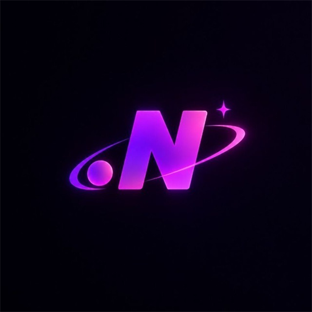
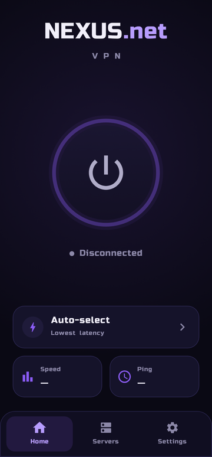
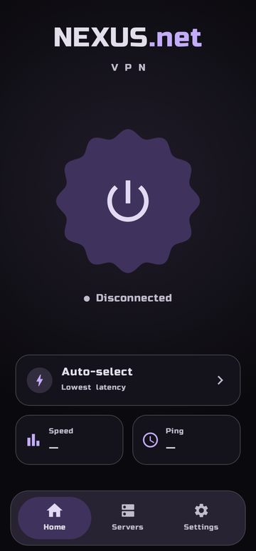
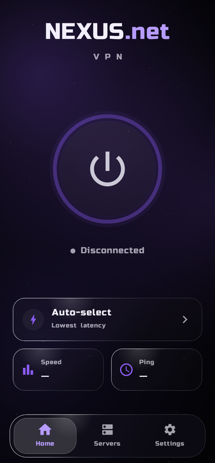
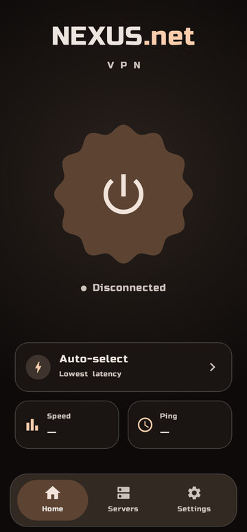

<div align="center">



# NEXUS.net

**Быстрый VPN-клиент для Android на базе Xray Core**

<a href="https://github.com/huqore/nexus.net/releases/latest"></a>
<a href="https://github.com/huqore/nexus.net/releases"></a>


<br><br>

<a href="https://github.com/huqore/nexus.net/releases/latest"></a>

<br>

[Сайт](https://nexus-net.xyz) · [Telegram-бот](https://t.me/NEXUSnet_robot) · [Поддержка](https://t.me/NEXUS_net_support)

<br>

&nbsp;
&nbsp;
&nbsp;


<sub>Fluent · Material You · Liquid Glass · Своя тема</sub>

</div>

## ✨ Что нового в 4.0

- 🎨 **Три стиля оформления** — Fluent, Material You Expressive и Liquid Glass с живыми бликами.
- 🌈 **Своя тема** — цвета и падающие частицы: сакура, снег, пепел с угольками. Плюс AMOLED и светлая тема.
- 👆 **Живая нижняя панель** — зажмите и ведите пальцем между вкладками.
- ⚡ **Стабильнее** — автовыбор держит один сервер, подключение быстрее, меньше расход батареи.

[Все изменения →](https://github.com/huqore/nexus.net/releases/latest)

## 🚀 Возможности

| 🔌 Подключение | 🎛 Удобство |
| --- | --- |
| VLESS, VMess, Trojan, Shadowsocks | Раздельная маршрутизация приложений |
| Ссылки, Xray JSON и подписки | Пинг серверов и статистика трафика |
| Вход и синхронизация через Telegram | Виджет и плитка быстрых настроек |
| Автовыбор лучшего сервера | Темы, стили и смена иконки |

## 📲 Установка

1. Скачайте APK со [страницы релиза](https://github.com/huqore/nexus.net/releases/latest).
2. Установите и откройте приложение.
3. Войдите через Telegram или добавьте ссылку / подписку — и подключайтесь в одно касание.

Обновления приходят прямо в приложении.

<details>
<summary><b>🛠 Сборка из исходников</b></summary>

<br>

Нужны **JDK 17** и **Android SDK Platform 35**. Укажите путь к SDK в `local.properties` (шаблон — [`local.properties.example`](local.properties.example)):

```bash
./gradlew assembleDebug      # Windows: gradlew.bat assembleDebug
```

Release-сборка — `assembleRelease`. Для подписи своим ключом задайте `KEYSTORE_PATH`, `KEYSTORE_PASSWORD`, `KEY_ALIAS`, `KEY_PASSWORD`; без них используется debug-ключ.

Если `app/libs/libv2ray.aar` нет, Gradle сам скачает Xray Core AAR `v26.10.29`.

**Стек:** Kotlin · Jetpack Compose · Material 3 · Android VpnService · Xray Core

</details>

<div align="center">
<sub>© NEXUS.net · <a href="https://nexus-net.xyz">nexus-net.xyz</a></sub>
</div>
